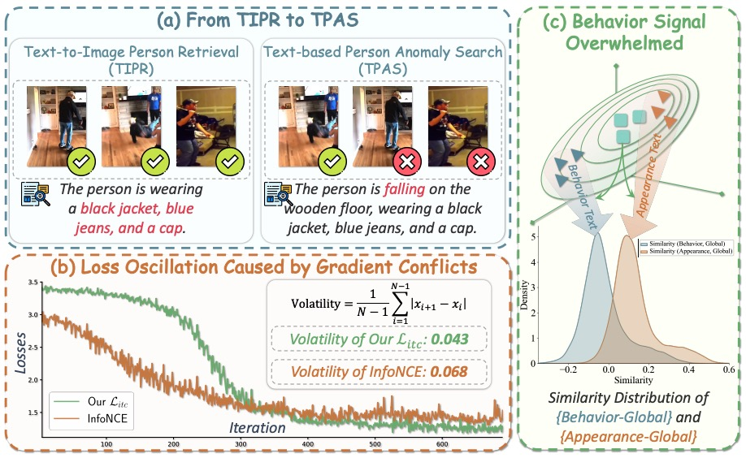
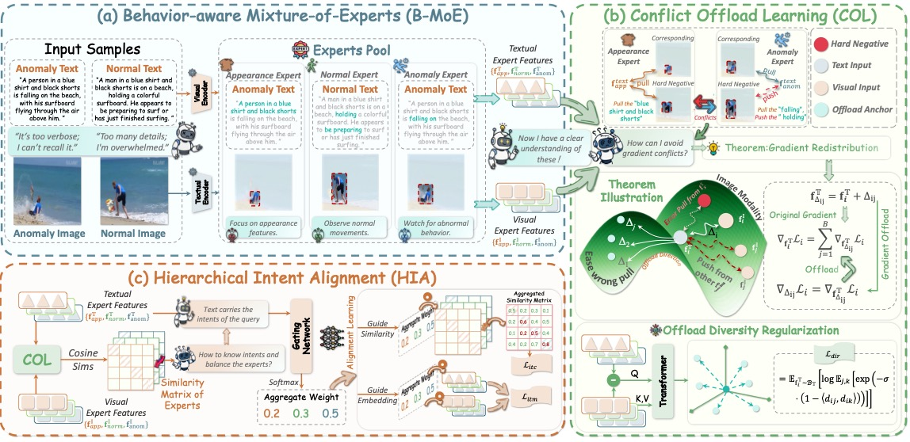

<a id="top"></a>

<div align="center">
  
  <h1>GradCO: Behavior-Aware Gradient-Conflict Offloading for Text-Based Person Anomaly Search</h1>
  <p>
    <a href="https://zhihfu.github.io/"><strong>Zhiheng Fu</strong></a><sup>1</sup> &nbsp;&nbsp;
    <a href="https://lee-zixu.github.io/"><strong>Zixu Li</strong></a><sup>1,†</sup> &nbsp;&nbsp;
    <a href="https://zivchen-ty.github.io/"><strong>Zhiwei Chen</strong></a><sup>1</sup> &nbsp;&nbsp;
    <a href="https://arcadiadream.github.io/HJL.github.io/"><strong>Jiale Huang</strong></a><sup>1</sup> &nbsp;&nbsp;
    <strong>Fangxu Liu</strong><sup>1</sup> &nbsp;&nbsp;
    <a href="https://jinhe-bi.github.io/"><strong>Jinhe Bi</strong></a><sup>2</sup> &nbsp;&nbsp;
    <a href="https://faculty.sdu.edu.cn/huyupeng1/zh_CN/index.htm"><strong>Yupeng Hu</strong></a><sup>1,✉</sup>
  </p>
  <p><sup>1</sup> Shandong University &nbsp;&nbsp; <sup>2</sup> National University of Singapore</p>
  <p><sup>†</sup> Project Leader &nbsp;&nbsp; <sup>✉</sup> Corresponding Author</p>
  <p>
    <a href="https://arxiv.org/abs/2610.37267"></a>
    <a href="https://github.com/ZhihFu/GradCO_TPAS"></a>
    
    
    <a href="LICENSE"></a>
  </p>
  <p>
    <a href="https://arxiv.org/abs/2610.37267">Paper</a> ·
    <a href="#-method">Method</a> ·
    <a href="#-results">Results</a> ·
    <a href="#-quick-start">Quick Start</a>
  </p>
</div>

## 📌 Introduction

Welcome to the official repository for **GradCO**, a behavior-aware framework for **Text-based Person Anomaly Search (TPAS)** and text-to-image person retrieval.

<div align="center">
  
  <p><strong>Figure 1.</strong> TPAS requires matching both appearance and behavior. Same-identity hard negatives can cause gradient conflicts, while strong appearance signals can overwhelm behavior cues.</p>
</div>

## 📖 Abstract

Text-based Person Anomaly Search (TPAS) retrieves pedestrians from natural-language descriptions of both appearance and behavior. It must preserve identity cues while recognizing fine-grained normal and anomalous actions. GradCO addresses two challenges in this setting: conflicting gradients from same-identity, different-behavior hard negatives, and appearance features overwhelming behavioral evidence during retrieval.

GradCO introduces three complementary components: Behavior-Aware Mixture-of-Experts (B-MoE) separates appearance, normal-behavior, and anomalous-behavior streams; Conflict Offload Learning (COL) uses pair-conditioned anchors to offload conflicting gradients; and Hierarchical Intent Alignment (HIA) aggregates expert features and similarities with query-conditioned weights.

## 📢 News and Updates

- **[2026-10-27]** 🚀 The GradCO preprint is available on [arXiv](https://arxiv.org/abs/2610.37267).
- **[2026-10-27]** 💻 The GradCO code is released in this repository.

## 🧠 Method

<div align="center">
  
  <p><strong>Figure 2.</strong> Overview of GradCO. B-MoE learns appearance and behavior expert streams, COL offloads conflicting gradients through pair-conditioned anchors, and HIA combines expert information according to the query.</p>
</div>

The implementation is in [`models/model_X2VLM.py`](models/model_X2VLM.py). GradCO builds on an X²-VLM vision-language backbone and applies behavior-aware experts to both image and text representations.

| Component | Role |
| --- | --- |
| **B-MoE** | Learns appearance, normal-behavior, and anomalous-behavior expert streams from retrieval objectives, without expert-specific semantic labels. |
| **COL** | Introduces pair-conditioned offload anchors in similarity computation to reduce hard-negative gradient conflict on the main text representations. |
| **HIA** | Uses query-conditioned weights to combine expert similarities and features for retrieval. |

The supplied configurations use BEiT-v2 as the image encoder and BERT as the text encoder. Training combines contrastive, image-text matching, and masked language modeling losses with conflict-offload regularization.

## 📑 Table of Contents

- [Introduction](#-introduction)
- [Abstract](#-abstract)
- [News and Updates](#-news-and-updates)
- [Method](#-method)
- [Benchmarks](#-benchmarks)
- [Results](#-results)
- [Getting Started](#-getting-started)
- [Project Structure](#-project-structure)
- [Data Preparation](#-data-preparation)
- [Quick Start](#-quick-start)
- [Acknowledgements](#-acknowledgements)
- [Contact](#-contact)
- [Related Projects](#-related-projects)
- [Citation](#-citation)
- [License](#-license)

## 📊 Benchmarks

GradCO is evaluated on Text-based Person Anomaly Search (TPAS) and Text-to-Image Person Retrieval (TIPR):

| Task | Benchmark / setting | Configuration |
| --- | --- | --- |
| TPAS | PAB | [`configs/tpas_X2VLM.yaml`](configs/tpas_X2VLM.yaml) |
| TPAS | PAB Multi-Weather and UCC OOD | [`configs/tpas_X2VLM.yaml`](configs/tpas_X2VLM.yaml) |
| TIPR | CUHK-PEDES | [`configs/itr_cuhk_X2VLM.yaml`](configs/itr_cuhk_X2VLM.yaml) |
| TIPR | ICFG-PEDES | [`configs/itr_icfg_X2VLM.yaml`](configs/itr_icfg_X2VLM.yaml) |
| TIPR | RSTPReID | [`configs/itr_rstp_X2VLM.yaml`](configs/itr_rstp_X2VLM.yaml) |
| TIPR | UFine6926 and UFine3C | [`configs/itr_ufine_X2VLM.yaml`](configs/itr_ufine_X2VLM.yaml) |

PAB is the in-distribution TPAS benchmark. Multi-Weather evaluates robustness to weather and lighting changes, while UCC is used for out-of-distribution evaluation. UFineBench includes the UFine6926 and UFine3C settings.

## 🏆 Results

The following headline results are reported in the [arXiv v1 paper](https://arxiv.org/abs/2610.37267). Retrieval scores are percentages; see the paper for full tables, baselines, and evaluation protocols.

### TPAS

| Setting | GradCO R@1 | CMP R@1 | GradCO mAP | CMP mAP |
| --- | ---: | ---: | ---: | ---: |
| PAB, 0.1M gallery | **85.39** | 83.06 | **92.13** | 90.41 |
| Multi-Weather mean | **72.20** | 67.12 | **80.67** | 77.44 |
| UCC OOD, 1M gallery | **62.53** | 55.23 | **52.01** | 44.35 |

### TIPR

The paper reports the following scores in its `Avg` column:

| Benchmark | GradCO | Strongest prior result in the paper |
| --- | ---: | ---: |
| CUHK-PEDES | **88.87** | 88.77 (Bi-IRRA) |
| ICFG-PEDES | **79.85** | 79.79 (Bi-IRRA) |
| RSTPReID | **84.73** | 84.17 (Bi-IRRA) |
| UFine6926 | 95.13 | **95.18** (Bi-IRRA) |
| UFine3C | **82.01** | 74.63 (CFAM) |

## 📦 Getting Started

Clone the repository:

```bash
git clone https://github.com/ZhihFu/GradCO_TPAS.git
cd GradCO_TPAS
```

### Requirements

- Python 3.10
- Linux with NVIDIA GPUs; distributed training uses NCCL and the launcher uses POSIX shell syntax
- A PyTorch/torchvision pair compatible with the installed CUDA runtime

Create an environment and install dependencies. The following PyTorch command is an example for CUDA 11.8; choose the matching build for your system.

```bash
conda create -n gradco python=3.10
conda activate gradco

pip install torch==2.2.0 torchvision==0.17.0 --index-url https://download.pytorch.org/whl/cu118
pip install -r requirements.txt
python -m nltk.downloader wordnet omw-1.4
```

The dependency list reflects imports in this repository. A complete end-to-end training environment has not been validated; the custom text encoders use Transformers 4.x APIs.

### Pretrained Weights

Datasets and model weights are not included. Prepare an X2-VLM checkpoint compatible with the selected backbone and a BERT tokenizer/configuration directory. The supplied configurations use `configs/config_beit2_base.json` and `bert-base-uncased`.

```text
checkpoint/
  x2vlm_base_1b.th
bert-base-uncased/
  config.json
  vocab.txt
  tokenizer_config.json
```

Set model and tokenizer paths in the selected task YAML and pass the pretrained checkpoint with `--checkpoint`. For offline use, point `text_encoder` to a local directory whose name contains `bert-base-uncased`, as required by the current tokenizer selection logic. The pretrained loader expects projection weights such as `text_proj.weight` and `text_proj.bias`; review its loading messages to confirm checkpoint compatibility.

## 📂 Project Structure

```text
GradCO_TPAS/
├── gradco-logo.png         # Project logo
├── GradCO-Intro.png        # Motivation and introduction figure
├── GradCO.png              # GradCO framework figure
├── configs/                # TPAS and TIPR experiment configurations
├── dataset/                # Text-based person retrieval data loaders
├── dataset_TPS/            # PAB / TPAS data loaders
├── models/
│   └── model_X2VLM.py       # GradCO model
├── Search_TPS_X2VLM.py      # Training and task orchestration
├── run_TPS.py               # Distributed launcher
├── eval.py                  # TIPR evaluation metrics
└── eval_TPS.py              # TPAS evaluation metrics
```

## 💾 Data Preparation

Obtain PAB images and annotations from the original [PAB/CMP project](https://github.com/Shuyu-XJTU/CMP) and follow its dataset terms. The supplied PAB configuration uses training shards 0 through 7.

```text
data/PAB/
├── annotation/
│   ├── train/
│   │   ├── attr_0.json
│   │   └── ... attr_7.json
│   ├── test/
│   │   ├── attr.json
│   │   └── ucc.json
│   └── multi-weather/
│       └── multi-weather_*.json
├── train/
├── test/
└── ucc/
```

PAB training annotations contain `image`, `caption`, and `image_id`. When hard-negative sampling is enabled, they also contain `hard_i`, `hard_c`, and `hard_i_id`; `hard_i` is resolved relative to `image_root/train/`. Pose images are only needed when `be_pose_img` is enabled; the supplied configurations disable it.

For each task, prepare the corresponding image files and JSON annotations, then update `image_root`, `image_root_test` (where present), `train_file`, `val_file`, and `test_file` in the YAML. Set `ifSpecial: True` in the UFine configuration for UFine6926, or `False` for UFine3C.

The standalone PAB evaluation loop uses `--data_root` for annotation paths; this does not rewrite image or training paths in the YAML. Pass it explicitly rather than relying on the `/data/PAB` default.

## 🚀 Quick Start

### Training

Run commands from the repository root. Single-GPU PAB training:

```bash
python run_TPS.py \
  --task tpas \
  --devices 0 \
  --nproc 1 \
  --checkpoint checkpoint/x2vlm_base_1b.th \
  --output_dir output/gradco_tpas \
  --data_root data/PAB \
  --num_sub_experts 4 \
  --col_lambda_dir 0.1
```

For four GPUs, use `--devices 0,1,2,3 --nproc 4`. Use one process per selected GPU. Other task names are `itr_cuhk`, `itr_icfg`, `itr_rstp`, and `itr_ufine`, each mapped by the launcher to its corresponding YAML configuration.

`--bs`, `--epo`, and `--lr` override the configured batch size, epoch count, and learning rate when positive. `--seed` defaults to 42. Use the distributed launcher even for one GPU because the training and evaluation loops call distributed barriers.

Training evaluates the configured test set each epoch and writes `log.txt`, `config.yaml`, and `checkpoint_best.pth` under `--output_dir`. The best checkpoint is selected by test R@1. The saved YAML is written before command-line overrides, so retain the launch command alongside your results.

### Evaluation

Training reports R@1, R@5, R@10, mAP, and mINP. The standalone `--evaluate` branch is currently PAB-specific: it iterates over the original, OOD, and configured Multi-Weather annotation files regardless of the selected task. It is not a standalone evaluation entry point for the other TIPR benchmarks.

The current evaluation entry point uses the pretrained-weight remapping loader rather than a dedicated trained-checkpoint loader. Since GradCO inherits the base text projection, its state dictionary includes `text_proj` keys; however, the loader also remaps text encoder weights and overwrites `tl_text_proj` from `text_proj`. Verify trained-checkpoint restoration before relying on standalone evaluation results.

## 🙏 Acknowledgements

This implementation builds on [X²-VLM](https://arxiv.org/abs/2211.12402) and uses the [PAB/CMP](https://github.com/Shuyu-XJTU/CMP) benchmark. Please follow the corresponding code, checkpoint, and dataset terms.

## ✉️ Contact

For questions or feedback, please open an [issue](https://github.com/ZhihFu/GradCO_TPAS/issues) or contact [Zhiheng Fu](mailto:fuzhiheng8@gmail.com).

## 🔗 Related Projects

Selected open-source projects from our team:

- **[Air-Know](https://github.com/iLearn-Lab/CVPR26-Air-Know)** — knowledge-calibrated robust composed image retrieval (CVPR 2026).
- **[ConeSep](https://github.com/iLearn-Lab/CVPR26-ConeSep)** — robust noise unlearning for composed image retrieval (CVPR 2026).
- **[TEMA](https://github.com/iLearn-Lab/ACL26-TEMA)** — a benchmark for multi-modification composed image retrieval (ACL 2026).
- **[INTENT](https://github.com/iLearn-Lab/AAAI26-INTENT)** — noise mitigation for robust composed image retrieval (AAAI 2026).

## 📝 Citation

If you use this work, please cite the paper:

```bibtex
@misc{fu2026gradco,
  title = {GradCO: Behavior-Aware Gradient-Conflict Offloading for Text-Based Person Anomaly Search},
  author = {Zhiheng Fu and Zixu Li and Zhiwei Chen and Jiale Huang and Fangxu Liu and Jinhe Bi and Yupeng Hu},
  year = {2026},
  eprint = {2610.37267},
  archivePrefix = {arXiv},
  primaryClass = {cs.CV},
  url = {https://arxiv.org/abs/2610.37267}
}
```

## 📄 License

This project is released under the [MIT License](LICENSE).

<div align="center">
  <a href="#top">Back to top</a>
</div>
